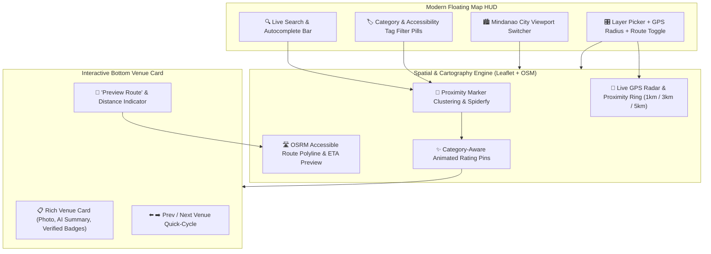

# AccessMap Interactive Map Engine — Modernization & Interactivity Plan

This plan outlines the architectural and visual upgrades to make the **AccessMap Interactive Map Engine** significantly more interactive, responsive, and modern across both the modular React codebase (`Src/`) and the zero-dependency standalone preview (`index.html`).

---

## Architecture & Feature Flow

---

## Pillar 1: Marker Clustering & Custom Category/Rating Animated Pins

Currently, pins are static circles (`Src/components/MapView.tsx`) or basic SVG teardrops (`index.html`) that overlap at regional zoom levels (e.g., Zoom 7–11 over Mindanao, CDO, or Davao).

### 1.1 Smart Spatial Clustering & Spiderfying
- **Regional Grouping**: Group nearby pins dynamically when zoomed out (Zoom < 14) into color-coded cluster badges showing the venue count and average accessibility tier of the cluster.
- **Interactive Cluster Expansion**: Clicking a cluster smoothly flies into the cluster bounds (`flyToBounds`) or spiderfies overlapping pins at street level.
- **Zero-Dependency & React Parity**:
  - In `index.html`: Integrate `Leaflet.markercluster` via CDN (with custom cluster icon renderer styled with Tailwind).
  - In `Src/utils/spatialCluster.ts` & `Src/components/MapView.tsx`: Provide a lightweight viewport-aware spatial clustering utility (or `leaflet.markercluster` compatible layer) so it works seamlessly without breaking parent repo dependencies.

### 1.2 Category-Aware Animated SVG Pins
- **Rich Pin Anatomy**: Upgrade pins to display:
  1. **Color Tier Ring**: Emerald (`>= 4.0★`), Amber (`2.5–3.9★`), Rose (`< 2.5★`), or Slate (`Unrated`).
  2. **Category Vector Icon**: Embedded SVG icon inside the pin head (🛍️ Shopping, 🏥 Healthcare, 🎓 Education, ☕ Dining, 🌳 Public Space).
  3. **Floating Rating Pill**: Mini badge displaying the star score (`4.8★`) on hover or when zoomed in (`>= 15`).
- **Micro-Interactions**:
  - Selected pin gets an animated radar pulse ring, elevated `z-index`, and smooth scale-up transition.
  - Hovering a pin shows a sleek custom glassmorphic tooltip with venue name, category, and top accessibility tag.

---

## Pillar 2: Interactive On-Map Search, Category & Accessibility Tag Filter Pills

Currently, users cannot search or filter pins directly on the map canvas.

### 2.1 Floating Glassmorphic Search & Filter Bar
- **Live Instant Search**:
  - Search input with keyboard shortcut (`/`) to filter pins by venue name, address, city, or accessibility feature.
  - Autocomplete dropdown showing matching venues with distance, rating badge, and instant `flyTo` on selection.
- **Horizontal Scrollable Filter Pills**:
  - **Category Filter Pills**: `All`, `Shopping`, `Healthcare`, `Dining & Cafe`, `Education`, `Public Space`.
  - **Accessibility Requirement Toggles**: Quick-filter chips for `♿ Wheelchair Entrance`, `🛗 Elevator`, `🚪 Ramp Available`, `🚻 Accessible Restroom`, `🔇 Quiet Zone`, and `✅ High Access (4.0★+)`.
- **Live Result Counter & Reset**:
  - Displays `"Showing X of Y locations"` with a one-click `"Reset Filters"` action and screen-reader announcements via `useA11y().announce`.

### 2.2 Regional City Switcher Pill Bar
- Add quick-jump city pills (`Mindanao Overview`, `Cagayan de Oro`, `Davao City`, `GenSan`, `Butuan`, `Zamboanga`, `Iligan`) to both `MapView.tsx` and `index.html` with dynamic header title updates based on the active viewport.

---

## Pillar 3: Accessible Routing / Directions Preview & Live Geolocation Radius

Currently, `MapFloatingCard.tsx` only computes straight-line Haversine distance, and `index.html` lacks geolocation and distance tools altogether.

### 3.1 Live Geolocation & Proximity Radius Ring
- **Interactive GPS Radar**:
  - Enhance the "Locate Me" control to render an accuracy circle plus a configurable **Proximity Radius Overlay** (`1 km`, `3 km`, `5 km`, or `Off`).
  - Option to **"Filter by Nearby"** or sort visible venues by distance from the user's current (or simulated CDO downtown center) coordinates.
- **Simulated Location Fallback**:
  - When testing on desktop or outside Mindanao, allow users to click *"Simulate Location in Downtown CDO"* (or drag the user reference point) to test proximity radius and live routing immediately.

### 3.2 On-Map Route Polyline & ETA Preview
- **Interactive Route Rendering**:
  - Add a **"Preview Route"** button on the floating venue card (`MapFloatingCard.tsx` and `#location-card` in `index.html`).
  - Fetches real street geometry via the free, keyless **OSRM Public Routing API** (`router.project-osrm.org/route/v1/foot/`) with an automatic graceful fallback to a curved geodesic dashed arc if offline.
- **Route HUD Banner**:
  - Draws a high-contrast animated dual-stroke polyline from the user's location (or CDO Downtown reference point) to the selected venue.
  - Displays route distance (`km`), estimated wheelchair/walking transit time (`mins`), and a warning badge if the destination has reported accessibility barriers (`aiBarriers` or disputed tags).
  - Includes a **"Clear Route"** button and fits the map bounds (`fitBounds`) to frame both origin and destination.

---

## Pillar 4: Enhanced Floating Venue Card & Dataset Synchronization

### 4.1 Upgraded `MapFloatingCard.tsx` & `index.html` Bottom Card
- **Visual & Functional Parity**:
  - Include venue thumbnail preview, AI Accessibility Summary callout (`aiSummary`), reported barriers alert (`aiBarriers`), and interactive **Previous / Next Venue (`←` / `→`)** navigation buttons to cycle through filtered pins on the map.
- **Full Dataset Sync in `index.html`**:
  - Upgrade `index.html` from its 7 hardcoded demo pins to the full 37+ Mindanao & Cagayan de Oro venues from `initialLocations.ts` and `mindanaoLocations.ts`.

---

## Proposed File Changes

| File Path | Action | Description |
| :--- | :--- | :--- |
| `Src/utils/routingAndSpatial.ts` | **Create** | OSRM keyless route fetcher with geodesic fallback, viewport clustering math, and category icon SVG generators. |
| `Src/components/MapSearchFilterBar.tsx` | **Create** | Floating glassmorphic search bar, autocomplete results list, category pills, accessibility tag toggles, and city quick-jump pills. |
| `Src/components/MapView.tsx` | **Modify** | Integrate search/filter state, custom category SVG pins, cluster markers, GPS proximity radius circle (`1km/3km/5km`), and interactive route polyline rendering. |
| `Src/components/MapFloatingCard.tsx` | **Modify** | Add "Preview Route" toggle, active route ETA/distance pill, venue photo thumbnail, AI summary/barrier preview, and Prev/Next venue stepper buttons. |
| `Src/index.ts` | **Modify** | Export new components (`MapSearchFilterBar`) and spatial/routing utilities, and fix the `INITIAL_LOCATIONS` named export casing. |
| `index.html` | **Modify** | Upgrade standalone preview with all 37+ Mindanao/CDO venues, search & tag filter bar, marker clustering, category SVG pins, GPS + CDO simulator, and live OSRM route preview. |
| `Documentation.md` | **Modify** | Log the modernization architecture and new interactive capabilities. |

---

## Verification Plan

1. **TypeScript & Module Verification**:
   - Verify all imports, exports, and TypeScript interfaces across `Src/` compile cleanly with zero type mismatches.
2. **Standalone `index.html` Interactive Testing**:
   - Verify marker clustering at Mindanao zoom (`Zoom 7–8`) and automatic unclustering/spiderfying at city zoom (`Zoom 14–16`).
   - Test instant search, category pills, and accessibility tag filters.
   - Test "Preview Route" polyline drawing, ETA calculation, and GPS radius ring toggles.
3. **Accessibility (A11y) Compliance**:
   - Ensure keyboard navigation (`Tab`, `Enter`, `Escape`, `/`), ARIA live announcements (`useA11y`), and High Contrast mode support across all new floating controls.
